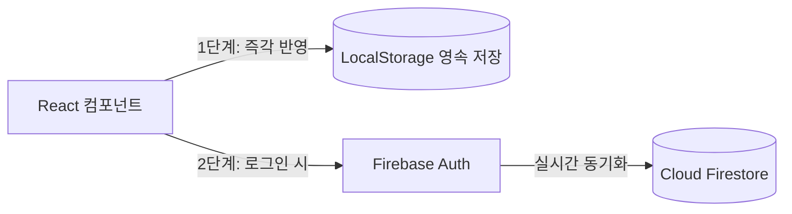

# 제품 요구사항 정의서 (PRD: Product Requirements Document)

---

## 1. 개요 (Overview)

- **제품명**: Assign Plan (Assgin Plan)
- **버전**: v1.0.5 (Toss Design System 적용)
- **카테고리**: 학습/생산성 (Study & Task Management)
- **문서 작성일**: 2026-10-09
- **배포 환경**: 
  - 프로덕션: `https://assignplan-0701.web.app`
  - 테스트 서버: `https://assignplan-0701--testserver-3t8o4zxj.web.app`

### 1.1 제품 비전
Assign Plan은 복잡하고 무거운 일반 일정 관리 도구에서 벗어나, **대학생 및 이러닝 수강생이 직관적으로 과제 제출 마감과 강의 수강 일정을 놓치지 않도록 돕는 모바일 퍼스트 학업 플래너**이다.  
토스 디자인 시스템(TDS)의 정갈한 비주얼 언어와 친절한 대화형 해요체 톤앤매너를 바탕으로, 불필요한 인지 부하를 최소화하고 행동을 빠르게 완료할 수 있는 매끄러운 사용자 경험을 제공한다.

---

## 2. 타깃 사용자 및 핵심 가치 (Target & Problem Statement)

### 2.1 타깃 페르소나 (Target Persona)
- **주 타깃**: 대학교 재학생, 온라인 부트캠프/학점은행제/이러닝 수강생
- **사용자 특성**:
  - 매주 반복되는 온라인 녹화 강의와 제출 기한이 정해진 과제를 동시에 관리해야 함
  - 무거운 캘린더나 노션 대신, 폰 화면에서 한눈에 "오늘 마감인 것"과 "남은 일정"을 확인하고 체크하길 원함
  - 마감일 중심의 명확하고 단순한 체크리스트가 필요함

### 2.2 해결하고자 하는 문제 (Core Problems Solved)
1. **과도한 기능과 복잡도**: 기존 일정 관리 앱은 시간 단위 타임블록, 다양한 태그 등 설정할 것이 많아 강의/과제 등록 자체가 부담스러움.
2. **마감 임박 인지의 부재**: 여러 강의와 과제가 섞여 있을 때 어떤 것이 당장 오늘까지인지 직관적으로 파악하기 어려움.
3. **불편한 모바일 조작감**: 모바일 웹에서 폼 입력 창을 닫거나 날짜를 고를 때 조작감이 부자연스러움.

### 2.3 핵심 가치 제안 (Key Value Propositions)
- **한눈에 보는 강의 & 과제 분리**: 강의(수강)와 과제(제출)를 명확한 카드 섹션으로 분리하여 관리.
- **당일 마감 시각적 강조**: 오늘 마감인 항목의 날짜 배지를 선명한 빨간색으로 표기하여 긴급성 전달.
- **1:1 실시간 물리적 바텀시트**: 핸들바를 직접 잡고 위/아래로 실시간 조작하여 높이를 조절하고 닫을 수 있는 쾌적한 인터랙션.
- **가볍고 빠른 웹 환경**: 모바일 웹/PWA 환경에 최적화된 단일 컬럼 모바일 셸.

---

## 3. 현행 기능 명세 (Current Features - v1.0.5)

### 3.1 상단 내비게이션 (Header)
- **타이틀**: `Assgin Plan` (상단 배경과 자연스럽게 결합된 일체형 헤더)
- **우측 액션 영역**:
  - **검색 아이콘**: 클릭 시 준비 중 안내 토스트 표시
  - **설정 아이콘**: 클릭 시 90도 회전 애니메이션과 함께 설정 팝오버 메뉴 오픈
  - **추가 버튼 (`+ 추가`)**: 토스 블루 알약형 버튼. 클릭 시 강의/과제 선택 드롭다운 오픈
- **상호 배타적 토글 로직**: 설정 메뉴가 열린 상태에서 추가를 누르면 설정창이 닫히고 추가창만 열리며, 그 반대도 동일하게 동작.

### 3.2 일정 목록 관리 (Item Sections)
- **강의 / 과제 독립 섹션 카드**:
  - 순백색(`white`) 바탕, 24px 라운드(`radius-3xl`), 섬세한 헤어라인 테두리
  - 미완료 항목 개수를 표시하는 토스 블루 배지
  - 날짜순 자동 정렬 (과거/오늘/미래 순)
- **TDS 체크박스 인터랙션**:
  - 22×22px, 6px 라운드 사각 체크박스
  - 완료 시 토스 블루 배경 + 화이트 체크마크 전환, 텍스트 취소선 및 흐림 처리
- **오늘 마감 강조 표기**:
  - 당일 마감인 미완료 항목의 날짜 배지는 빨간색(`text-[#F04452] bg-[#FEE2E2] font-bold`)으로 전환
- **빈 상태(Empty State)**:
  - 등록된 항목이 없을 때 친절한 해요체 안내 제공 (*"남은 강의/과제가 없어요"*, *"새로운 강의/과제를 등록하고 관리해 보세요"*)

### 3.3 등록 바텀시트 (AddModal)
- **진입 방식**: 상단 `+ 추가` 버튼 클릭 후 `강의 추가하기` 또는 `과제 추가하기` 선택
- **1:1 실시간 드래그 핸들러**:
  - 상단 회색 알약형 핸들(`w-12 h-1.5`)을 마우스나 터치로 잡으면 1:1 실시간으로 시트 높이가 손가락/커서를 따라 증감
  - **드래그 해제 스냅 로직**:
    - 화면 35% 이하로 내렸을 때: 시트 닫힘
    - 상단으로 충분히 끌어올렸을 때: 전체 화면(화면의 88% 높이)으로 자동 확장되어 넉넉한 메모 작성 공간 확보
    - 그 외: 표준 높이(~500px)로 부드럽게 복귀
- **헤더 UI**: X버튼 없이 중앙에 타이틀(`강의 추가하기` / `과제 추가하기`) 단독 배치
- **입력 폼**:
  - 제목 입력 필드 (48px 높이, 12px 라운드, 포커스 시 토스 블루 테두리)
  - 마감 날짜 선택 트리거 (선택된 날짜 배지 표시)
  - 메모 텍스트에어리어 (확장 시 높이 자동 증가)
  - 56px XL 토스 블루 저장 버튼 (제목 미입력 시 비활성화)

### 3.4 캘린더 및 날짜 선택 (DatePicker)
- **팝오버 캘린더 다이얼로그**:
  - 월 단위 그리드 뷰 (일~토 요일 헤더)
  - 오늘 날짜(블루 텍스트/배경 칩) 및 선택 날짜(블루 채움 원) 구분
  - 과거 날짜 선택 비활성화
- **슬라이드 애니메이션**:
  - 다음 달(`>`): 오른쪽에서 왼쪽으로 자연스럽게 진입
  - 이전 달(`<`): 왼쪽에서 오른쪽으로 자연스럽게 진입
- **선택 및 닫기 동작**:
  - 날짜 그리드 클릭 시 선택 상태만 갱신되며, 하단 **"완료"** 버튼을 눌러야 선택이 확정되고 창이 닫힘
- **년/월 휠 셀렉터 모드**:
  - 상단 년/월 텍스트 클릭 시 스크롤 가능한 휠 피커로 전환
  - 휠 피커에서 하단 "선택 완료" 버튼 클릭 시 전체 창이 닫히지 않고, 선택된 년/월의 캘린더 화면으로 복귀

### 3.5 설정 및 업데이트 내역 (Settings & Changelog)
- **알림 토글**: 토스 스위치 컴포넌트 (44×26px, 토스 블루 활성화 상태)
- **버전 정보 링크**: `v1.0.5` 배지 클릭 시 우측 슬라이드 드로어로 패치 내역 표시
- **패치 내역(Changelog)**: 버전별 카드 목록 형태, 최신 배지 및 변경 사항 글머리 기호 정리

---

## 4. 데이터 모델 및 시스템 아키텍처 (Data Architecture)

### 4.1 데이터 흐름 및 저장 전략 (2단계 구조)

1. **1단계 (Local Persistence)**:
   - 비로그인 상태에서도 브라우저 `localStorage`에 자동 저장되어 새로고침 후에도 등록한 일정 유지
2. **2단계 (Cloud Sync - 복구 예정)**:
   - Firebase Auth (Google Provider) 로그인 연동
   - 로그인 성공 시 로컬 데이터를 클라우드와 병합하고, 실시간 동기화 지원

### 4.2 Firestore 데이터베이스 스키마
- **경로 구조**:
  - `users/{USER_ID}/lectures/{LECTURE_ID}`
  - `users/{USER_ID}/task/{TASK_ID}`

- **도큐먼트 필드 명세**:
| 필드명 | 타입 | 설명 | 예시 값 |
|---|---|---|---|
| `id` | string | 고유 식별자 (타임스탬프 또는 UUID) | `"1728456123456"` |
| `title` | string | 강의명 또는 과제명 | `"운영체제 5강 과제"` |
| `memo` | string | 상세 메모 (선택 입력) | `"PDF 파일 3페이지 문제 풀이"` |
| `date` | map (object) | 마감 날짜 정보 | `{ year: 2026, month: 10, day: 14 }` |
| `completed` | boolean | 완료 여부 | `false` |
| `createdAt` | string / timestamp | 생성 시각 | `"2026-10-09T14:30:00Z"` |

---

## 5. UI/UX 디자인 시스템 규격 (TDS: Toss Design System)

본 프로젝트는 `design.md`에 정의된 **토스 디자인 시스템(TDS)**을 엄격하게 준수한다.

### 5.1 컬러 팔레트
- **브랜드 액센트**: 토스 블루 `blue-500` (`#3182F6`) — 화면당 1개의 가장 중요한 액션에만 적용
- **브랜드 서브**: `blue-50` (`#E8F3FF`) — 배지 배경, 활성 칩
- **표면 배경**:
  - 전체 앱 캔버스: `grey-100` (`#F2F4F6`)
  - 카드 및 모달 표면: `white` (`#FFFFFF`)
- **텍스트 컬러**:
  - Primary 텍스트: `grey-900` (`#191F28`) — 순수 검정이 아닌 차가운 네이비 계열 딥그레이
  - Secondary 텍스트: `grey-700` (`#4E5968`)
  - Tertiary / 힌트: `grey-500` (`#8B95A1`)
- **시맨틱 컬러**:
  - 마감 임박 / 에러: `red-500` (`#F04452`) / 연분홍 배경 (`#FEE2E2`)
  - 완료 / 성공: `green-500` (`#04B074`)

### 5.2 타이포그래피 및 보이스앤톤
- **폰트**: `Pretendard Variable`, system-ui
- **숫자 서식**: 날짜 및 카운터에 `tabular-nums` (고정폭 숫자) 강제 적용
- **보이스앤톤**: **대화형 해요체 통일**
  - 예: *"남은 강의가 없어요"*, *"새로운 강의를 등록해 보세요"*, *"아직 준비 중인 기능이에요"*

### 5.3 모션 & 인터랙션
- **팝오버 메뉴**: `origin-top-right`에서 `scale(0.3)`으로 시작해 튕기며 커지는 스프링 애니메이션 (`cubic-bezier(0.16, 1, 0.3, 1)`)
- **터치/버튼 피드백**: 활성 시 `scale(0.95)` 또는 `scale(0.98)`의 미세한 스케일 축소 반응

---

## 6. 향후 로드맵 및 미구현 기능 (Phase 2 Roadmap)

현재 UI에는 버튼이 배치되어 있으나 상세 동작이 정의되지 않은 기능들을 향후 개발 단계로 규정한다.

| 기능명 | 현재 상태 | 향후 구현 방향 (제안) |
|---|---|---|
| **검색 (Search)** | 토스트 안내 표시 | 상단 인라인 검색창 확장, 강의/과제 제목 및 메모 내용 실시간 필터링 |
| **더보기 (More)** | 토스트 안내 표시 | 섹션별 상세 페이지 진입: [전체 / 마감 임박 / 완료됨] 세부 탭 필터 및 일괄 완료/삭제 관리 |
| **반복 일정 (Repeat)** | 토스트 안내 표시 | 매주 특정 요일 수강 강의 등록 지원 (예: 매주 화/목 14시 강의 자동 생성) |
| **알림 (Alarm)** | 스위치 토글만 지원 | 마감 당일 오전 9시 또는 마감 1일 전 브라우저 Web Push / Firebase Cloud Messaging(FCM) 알림 발송 |
| **구글 로그인 복원** | 임시 제거 상태 | 헤더 우측 또는 설정 팝오버 내 구글 로그인 버튼 배치 및 Firestore 실시간 백업 활성화 |

---

## 7. 비기능 요구사항 (Non-Functional Requirements)

1. **반응형 모바일 셸**: 데스크톱에서도 최대 너비 480px의 중앙 모바일 뷰로 제한되어 앱과 동일한 사용성 유지.
2. **PWA 및 웹앱 지원**: `viewport-fit=cover`, Apple 모바일 웹앱 메타태그 적용.
3. **빌드 안정성**: TypeScript 컴파일(`tsc -b`) 에러 0건 유지.
4. **보안 규칙**: Firestore 보안 규칙을 통해 본인 `request.auth.uid == userId` 경로만 읽기/쓰기 허용되도록 배포 전 규칙 업데이트 필요.
