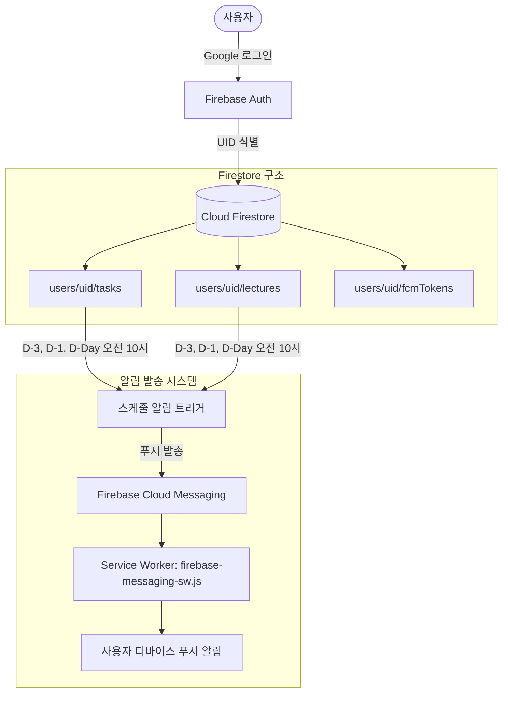

# 제품 요구사항 정의서 (PRD: Product Requirements Document)

---

## 1. 개요 (Overview)

- **제품명**: Assign Plan (Assgin Plan)
- **버전**: v1.1.0 (알림 기능 및 일정 관리 고도화)
- **카테고리**: 학습/생산성 (Study & Task Management)
- **문서 갱신일**: 2026-10-09
- **배포 환경**: 
  - 프로덕션: `https://assignplan-0701.web.app`
  - 테스트 서버: `https://assignplan-0701--testserver-3t8o4zxj.web.app`

### 1.1 제품 비전
Assign Plan은 복잡하고 무거운 일반 일정 관리 도구에서 벗어나, **대학생 및 이러닝 수강생이 직관적으로 과제 제출 마감과 강의 수강 일정을 놓치지 않도록 돕는 모바일 퍼스트 학업 플래너**이다.  
토스 디자인 시스템(TDS)의 정갈한 비주얼 언어와 친절한 대화형 해요체 톤앤매너를 바탕으로, 불필요한 인지 부하를 최소화하고 행동을 빠르게 완료할 수 있는 매끄러운 사용자 경험을 제공한다.

---

## 2. 타깃 사용자 및 핵심 가치 (Target & Problem Statement)

### 2.1 타깃 페르소나 (Target Persona)
- **주 타깃**: 대학교 재학생, 온라인 부트캠프/학점은행제/이러닝 수강생
- **사용자 특성**:
  - 매주 반복되는 온라인 녹화 강의와 제출 기한이 정해진 과제를 동시에 관리해야 함
  - 무거운 캘린더나 노션 대신, 폰 화면에서 한눈에 "오늘 마감인 것"과 "남은 일정"을 확인하고 체크하길 원함
  - 마감일 중심의 명확하고 단순한 체크리스트 및 적시 알림이 필요함

### 2.2 해결하고자 하는 문제 (Core Problems Solved)
1. **과도한 기능과 복잡도**: 기존 일정 관리 앱은 시간 단위 타임블록, 다양한 태그 등 설정할 것이 많아 강의/과제 등록 자체가 부담스러움.
2. **마감 임박 인지의 부재**: 여러 강의와 과제가 섞여 있을 때 어떤 것이 당장 오늘까지인지 직관적으로 파악하기 어려움.
3. **일정 망각 위험**: 앱을 켜지 않으면 마감 며칠 전 일정을 놓치기 쉬움 -> **적시 푸시 알림(D-3, D-1, 당일 10시)으로 완벽 방지**.

### 2.3 핵심 가치 제안 (Key Value Propositions)
- **한눈에 보는 강의 & 과제 분리**: 강의(수강)와 과제(제출)를 명확한 카드 섹션으로 분리하여 관리.
- **당일 마감 시각적 강조**: 오늘 마감인 항목의 날짜 배지를 선명한 빨간색으로 표기하여 긴급성 전달.
- **적시 스마트 마감 알림 (v1.1.0)**: 마감 3일 전, 1일 전, 그리고 당일 오전 10시에 푸시 알림을 자동 발송하여 학업 누락을 원천 차단.
- **1:1 실시간 물리적 바텀시트**: 핸들바를 직접 잡고 위/아래로 실시간 조작하여 높이를 조절하고 닫을 수 있는 쾌적한 인터랙션.
- **가볍고 빠른 웹 환경**: 모바일 웹/PWA 환경에 최적화된 단일 컬럼 모바일 셸.

---

## 3. 기능 명세 (Feature Specifications)

### 3.1 로그인 게이트 (Login Screen)
- **진입 제어**: 비로그인 상태일 경우 메인 셸 접근을 차단하고 클라우드 계정 연동을 유도하는 로그인 화면 단독 렌더링.
- **구성 요소**:
  - 앱 대표 아이콘 (`public/icon.png`) 및 브랜드 타이틀
  - 직관적인 핵심 가치 안내 카드 (강의 수강 관리 / 과제 마감 체크)
  - Google 계정 원클릭 로그인 버튼 (`signInWithPopup`)
  - 별도의 게스트/체험 로그인은 제공하지 않고 클라우드 동기화 계정 필수화

### 3.2 상단 내비게이션 (Header)
- **타이틀**: `Assgin Plan` (상단 배경과 자연스럽게 결합된 일체형 헤더)
- **우측 액션 영역**:
  - **검색 아이콘**: 클릭 시 준비 중 안내 토스트 표시
  - **설정 아이콘**: 클릭 시 90도 회전 애니메이션과 함께 설정 팝오버 메뉴 오픈
  - **추가 버튼 (`+ 추가`)**: 토스 블루 알약형 버튼. 클릭 시 강의/과제 선택 드롭다운 오픈
- **상호 배타적 토글 로직**: 설정 메뉴가 열린 상태에서 추가를 누르면 설정창이 닫히고 추가창만 열리며, 그 반대도 동일하게 동작.

### 3.3 일정 목록 관리 (Item Sections)
- **강의 / 과제 독립 섹션 카드**:
  - 순백색(`white`) 바탕, 24px 라운드(`radius-3xl`), 섬세한 헤어라인 테두리
  - 미완료 항목 개수를 표시하는 토스 블루 배지
  - 날짜순 자동 정렬 (과거/오늘/미래 순)
- **TDS 체크박스 인터랙션**:
  - 22×22px, 6px 라운드 사각 체크박스
  - 완료 시 토스 블루 배경 + 화이트 체크마크 전환
  - 완료 처리 시 350ms 후 Firestore `completed: true` 반영 및 미완료 목록에서 제외
- **오늘 마감 강조 표기**:
  - 당일 마감인 미완료 항목의 날짜 배지는 빨간색(`text-[#F04452] bg-[#FEE2E2] font-bold`)으로 전환
- **완료된 항목 필터링**:
  - `completed: true`인 지난 완료 일정은 메인 목록에 불러오지 않고 미완료 일정만 간결하게 표시

### 3.4 등록 바텀시트 (AddModal)
- **진입 방식**: 상단 `+ 추가` 버튼 클릭 후 `강의 추가하기` 또는 `과제 추가하기` 선택
- **1:1 실시간 드래그 핸들러**:
  - 상단 회색 알약형 핸들(`w-12 h-1.5`)을 잡고 위/아래로 실시간 조작
  - 화면 35% 이하로 내렸을 때 시트 닫힘, 상단 드래그 시 화면 88%로 확장
- **입력 폼**: 제목 입력 필드, 마감 날짜 선택 트리거, 메모 텍스트에어리어, 56px XL 토스 블루 저장 버튼

### 3.5 캘린더 및 날짜 선택 (DatePicker)
- 월 단위 그리드 뷰, 오늘 날짜 및 선택 날짜 구분, 과거 날짜 선택 비활성화
- 부드러운 좌우 슬라이드 전환 애니메이션
- 상단 년/월 클릭 시 스크롤 가능한 휠 피커 모드 전환

### 3.6 알림 발송 시스템 (Notification System - v1.1.0)
- **발송 스케줄 규칙 (3단계)**:
  1. **D-3 알림**: 마감일 3일 전 오전 10:00 (예: 10월 14일 마감 -> 10월 11일 10:00)
  2. **D-1 알림**: 마감일 1일 전 오전 10:00 (예: 10월 14일 마감 -> 10월 13일 10:00)
  3. **당일 알림**: 마감 당일 오전 10:00 (예: 10월 14일 마감 -> 10월 14일 10:00)
- **대상 범위**:
  - 강의(`lectures`) 및 과제(`tasks`) 공통 적용
  - 이미 완료 처리된(`completed: true`) 항목은 발송 대상에서 자동 제외
- **알림 메시지 템플릿**:
  - **D-3**: `[Assign Plan] {title} 마감 3일 전이에요` / `3일 뒤 마감인 {강의/과제}가 있어요. 미리 확인해 보세요!`
  - **D-1**: `[Assign Plan] {title} 마감이 내일이에요` / `내일까지 제출/수강해야 하는 {강의/과제}가 있어요.`
  - **당일**: `[Assign Plan] 오늘 마감: {title}` / `오늘 마감인 {강의/과제}가 있어요! 잊지 말고 완료해 보세요.`
- **기술 아키텍처**:
  - **FCM (Firebase Cloud Messaging)**: 백그라운드 푸시 알림 전송 (`firebase-messaging-sw.js` 수신)
  - **디바이스 토큰 관리**: 사용자가 알림 활성화 시 브라우저 토큰을 발급받아 `users/{uid}/fcmTokens`에 영속 저장
  - **Web Notification API**: 포그라운드(앱이 켜져 있는 상태) 수신 시 토스트 및 시스템 알림 배너 표출
- **설정 연동 UI**:
  - 설정 팝오버의 "알림 받기" 토스 스위치
  - 토글 ON 시 브라우저 알림 권한(`Notification.requestPermission()`) 요청 및 토큰 등록
  - 토글 OFF 시 알림 구독 해제 및 토스트 안내

---

## 4. 데이터 모델 및 시스템 아키텍처 (Data Architecture)

### 4.1 데이터 흐름도

### 4.2 Firestore 데이터베이스 스키마

#### 1. 강의 컬렉션 (`users/{USER_ID}/lectures/{ID}`) & 과제 컬렉션 (`users/{USER_ID}/tasks/{ID}`)
| 필드명 | 타입 | 설명 | 예시 값 |
|---|---|---|---|
| `title` | string | 강의명 또는 과제명 | `"융합적사고와글쓰기"` |
| `memo` | string | 상세 메모 | `""` 또는 `"과제 제출 양식 확인"` |
| `date` | map (object) | 마감 날짜 정보 | `{ year: 2026, month: 10, day: 11 }` |
| `completed` | boolean | 완료 여부 (false만 목록 표시) | `false` |
| `createdAt` | number (int64) | 생성 시각 (ms 타임스탬프) | `1791092392772` |

#### 2. FCM 토큰 컬렉션 (`users/{USER_ID}/fcmTokens/{TOKEN_ID}`)
| 필드명 | 타입 | 설명 | 예시 값 |
|---|---|---|---|
| `token` | string | 브라우저 FCM 등록 토큰 | `"fG8a...3kL9"` |
| `platform` | string | 디바이스 브라우저 환경 | `"web"` |
| `updatedAt` | number (int64) | 토큰 갱신 시각 | `1791530000000` |

---

## 5. UI/UX 디자인 시스템 규격 (TDS: Toss Design System)

- **브랜드 액센트**: 토스 블루 `blue-500` (`#3182F6`) — CTA 및 중요 강조
- **표면 배경**: 앱 배경 `grey-100` (`#F2F4F6`), 카드 `white` (`#FFFFFF`)
- **텍스트**: Primary `grey-900` (`#191F28`), Secondary `grey-700` (`#4E5968`), Hint `grey-500` (`#8B95A1`)
- **보이스앤톤**: **대화형 해요체 통일** (*"오늘 마감인 일정이 있어요"*, *"알림이 켜졌어요"*)

---

## 6. 버전 히스토리 및 개발 로드맵

| 버전 | 상태 | 주요 내용 |
|---|---|---|
| **v1.0.5** | 완료 | 토스 디자인 시스템(TDS) UI 전면 개편, 실시간 바텀시트 핸들러 |
| **v1.0.6** | 완료 | Google 로그인 게이트 구현, Firestore 실시간 동기화 및 캐시 버스팅 |
| **v1.1.0** | 완료 | 마감 알림 시스템 (D-3, D-1, 당일 오전 10시 FCM 푸시 발송) |
| **v1.1.1** | 완료 | 로그인 화면 내 기기별(iOS/Android) 홈 화면 앱 추가 가이드 UI 및 PWA 매니페스트/캐시 최적화 |
| **v1.1.2** | 완료 | 안드로이드(갤럭시) 알림 누락 버그 수정(44KB 경량 아이콘) 및 iOS 2회 중복 알림 방지 |
| **v1.1.3** | 완료 | GitHub Actions 기반 백그라운드 자동 푸시 스케줄러 구축 및 모바일 알림 안정화 |
| **v1.1.4** | 완료 | 웹앱(PWA) 자동 버전 감지·업데이트 적용 및 오전 10시 정각 알림 스케줄 확정 |
| **v1.2.0** | 예정 | 인라인 검색 기능 및 과제/강의 상세 필터링 페이지 |
| **v1.3.0** | 예정 | 반복 추가 페이지 |

---

## 7. 비기능 요구사항 (Non-Functional Requirements)

1. **배포 안정성**: `npm run build` 검증 통과 및 오류 0건 유지.
2. **배포 제어 원칙**: 기본적으로 로컬 커밋 및 테스트 서버(`TestServer`)에 배포. 사용자 요청 시에만 GitHub 푸시(`git push`) 및 운영 배포(`firebase deploy`)를 선별 실행.
3. **PWA & 모바일 최적화**: iOS 및 Android 홈 화면 추가(PWA) 시 백그라운드 푸시 수신 지원.
